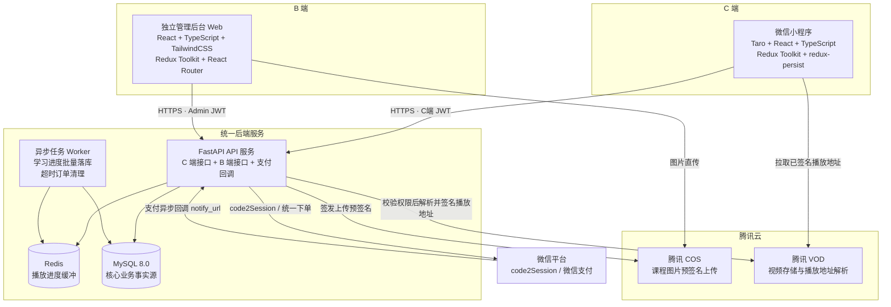
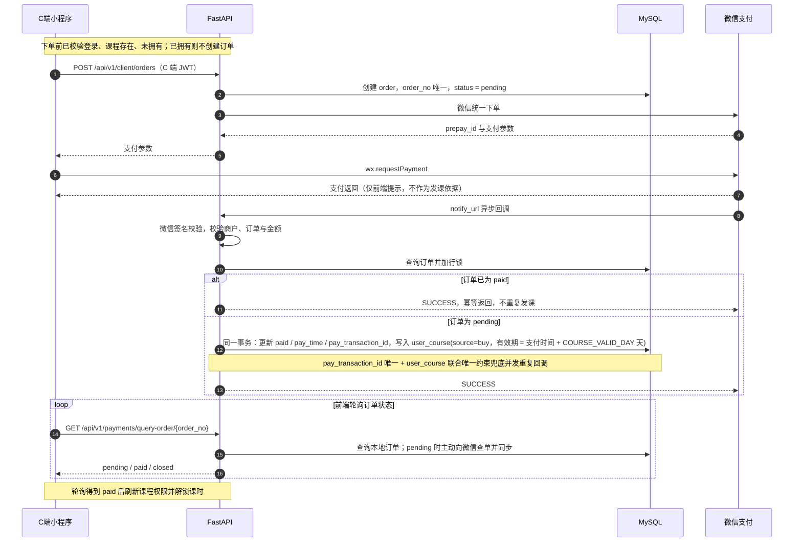
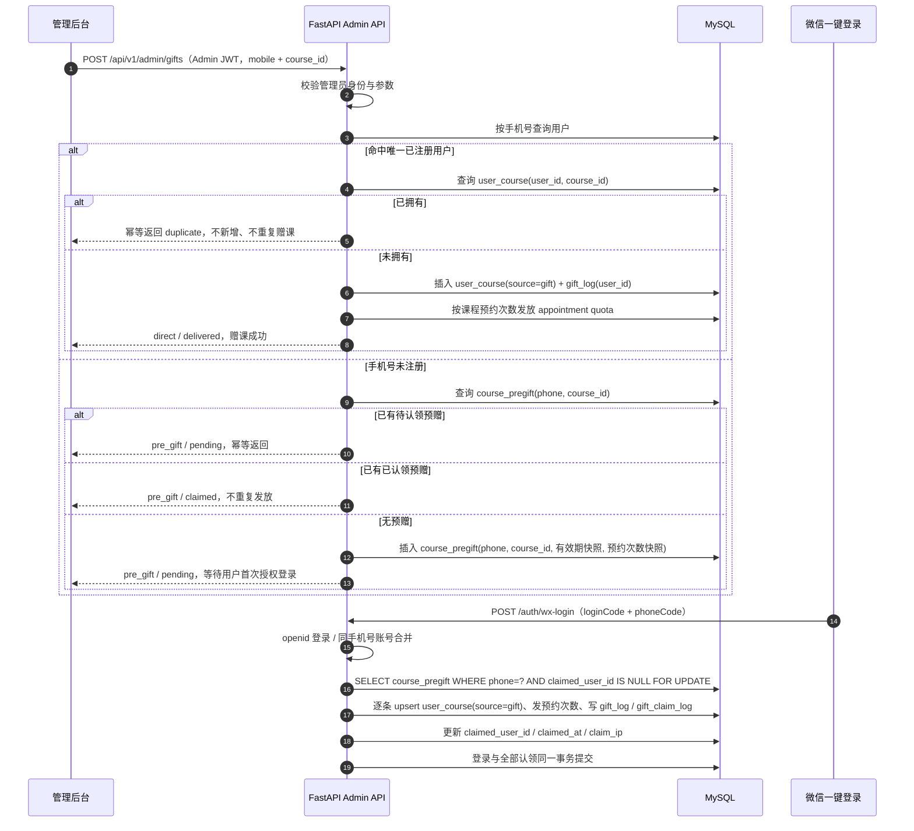
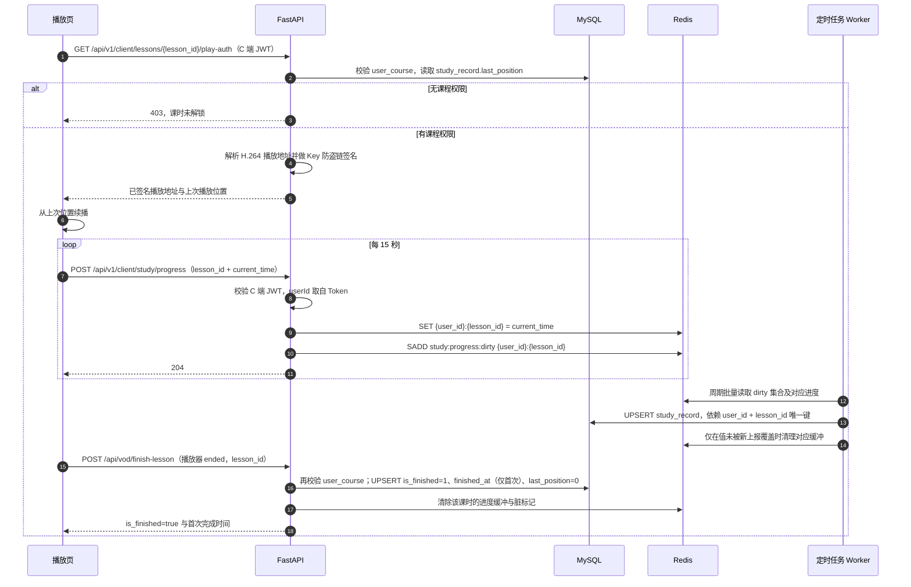
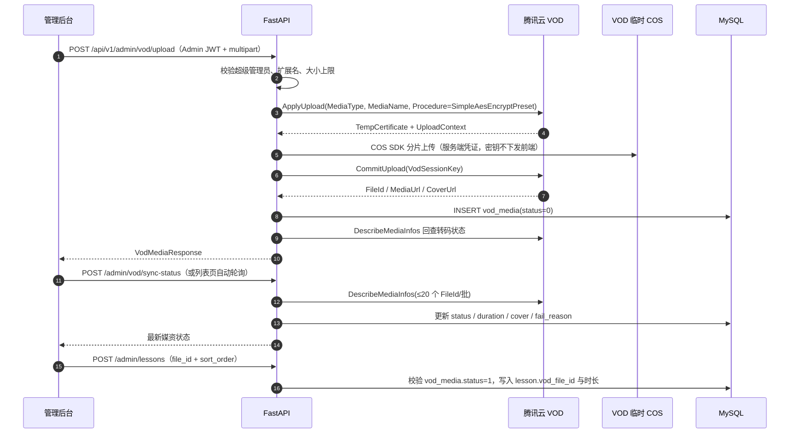
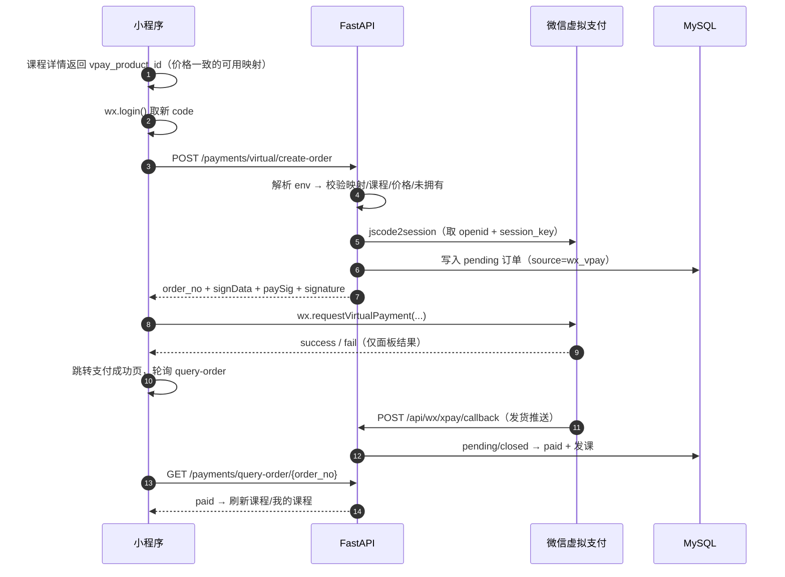
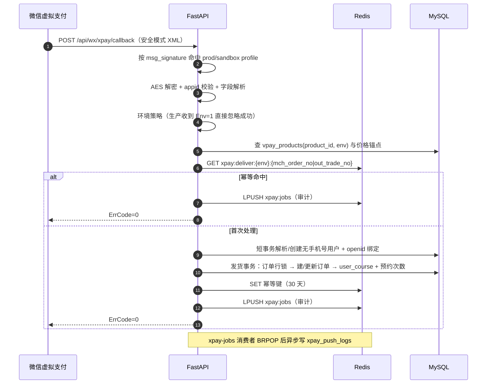

# 禾下美学院｜知识付费 · 系统架构设计

> 阶段：阶段 1（项目骨架与架构文档）
> 状态：仅定义目标架构、边界与不变量，不包含业务代码、依赖安装、数据库迁移和部署编排。

---

## 1. 文档边界

本文档是全项目后续阶段共同遵循的架构基线，重点回答四件事：

1. 系统由哪些独立部署单元组成，各自职责是什么；
2. C 端、B 端、支付回调三条鉴权链路如何隔离；
3. 支付发课、后台赠课、学习进度上报三个核心流程如何保证正确与幂等；
4. 哪些业务能力在本项目范围内，哪些明确禁止开发。

后续阶段的接口、数据表、页面实现均不得突破本文档定义的边界与不变量。

---

## 2. 系统组成与技术栈

| 组成 | 技术栈 | 职责 |
| --- | --- | --- |
| C 端小程序 `miniprogram/` | Taro + React + TypeScript + Redux Toolkit + redux-persist | 首页、商学院课程广场、课程详情、视频播放、个人中心 |
| B 端后台 `admin-web/` | React + TypeScript + Redux Toolkit + react-router-dom + TailwindCSS + axios | 管理员登录、课程/课时管理、媒资管理、VOD 视频库对比与入库、赠课、用户课程管理、赠课日志、订单查询、系统配置 |
| 统一 API `backend/` | FastAPI + Python 3.11 + 异步 SQLAlchemy + Alembic + MySQL 8.0 + Redis | 同时服务 C 端与 B 端，签发播放鉴权，处理支付回调与异步任务 |
| 部署 `deploy/` | Docker + Docker Compose + Nginx | 本地开发与生产两套编排、反向代理、静态站点与密钥挂载 |
| 云服务 | 腾讯 COS + 腾讯 VOD + 微信支付 | 图片预签名上传、VOD 鉴权播放、微信统一下单与异步回调 |

**架构原则：**

- **单一后端、双端隔离**：C 端与 B 端共用一个 API 服务，但使用两套独立 JWT 密钥和独立路由命名空间，权限完全隔离。
- **MySQL 为唯一事实源**：课程、订单、课程拥有关系、学习进度最终数据均落 MySQL；Redis 只承担缓冲、短期状态和缓存。
- **服务端裁决权限**：课时是否解锁、是否允许播放、是否可赠课，全部由后端根据 `user_course` 计算，前端不自行判断。
- **幂等靠约束兜底**：业务查询只能减少冲突，唯一索引和事务才是最终一致性保障。
- **敏感信息只留在后端**：小程序密钥、支付私钥、COS/VOD 密钥、Admin JWT 密钥不得下发到任意前端。

---

## 3. 整体架构图



**部署形态：**

- API 服务与定时任务 Worker 使用同一份后端代码、不同启动入口，避免多 API 副本重复执行定时任务。
- B 端后台是独立静态站点，由 Nginx 托管；C 端小程序由微信开发者工具构建并上传，不通过 Docker 部署。
- 本地开发使用一套 Compose，生产使用另一套 Compose；两者共享镜像构建逻辑但不共享配置与密钥。

---

## 4. 目录职责

```text
beauty-course-mp/
├── miniprogram/
│   ├── config/                     # Taro 编译配置与环境区分
│   └── src/
│       ├── api/                    # C 端请求封装、拦截器
│       ├── assets/                 # 小程序静态资源
│       ├── components/             # C 端通用组件
│       ├── constants/              # 常量、枚举、默认配置
│       ├── pages/
│       │   ├── home/               # 首页
│       │   ├── academy/            # 商学院课程广场
│       │   ├── course-detail/      # 课程详情
│       │   ├── player/             # 视频播放页
│       │   └── profile/            # 个人中心
│       ├── store/
│       │   └── slices/             # Redux Toolkit 状态切片
│       ├── types/                  # C 端 TypeScript 类型
│       └── utils/                   # 请求、登录、播放进度等工具
├── admin-web/
│   ├── public/                     # B 端静态资源
│   └── src/
│       ├── api/                    # 管理后台请求封装、Admin Token 注入
│       ├── components/             # 后台通用组件
│       ├── layouts/                # 后台布局与导航
│       ├── pages/
│       │   ├── login/              # 管理员登录
│       │   ├── courses/            # 课程管理
│       │   ├── lessons/            # 课时管理
│       │   ├── gifts/              # 赠课发放
│       │   ├── gift-logs/          # 赠课日志查询
│       │   ├── orders/             # 订单查询
│       │   └── system-config/      # 系统配置管理
│       ├── router/                 # 路由与登录守卫
│       ├── store/
│       │   └── slices/             # 后台 Redux 状态
│       ├── styles/                 # TailwindCSS 入口与全局样式
│       ├── types/                  # B 端 TypeScript 类型
│       └── utils/                   # Token、日期、上传等工具
├── backend/
│   ├── alembic/
│   │   └── versions/               # 数据库迁移脚本
│   ├── app/
│   │   ├── api/
│   │   │   ├── admin/              # B 端接口，Admin JWT
│   │   │   ├── client/             # C 端接口，C 端 JWT
│   │   │   └── payment/            # 微信支付回调，仅签名校验
│   │   ├── core/                   # 配置、数据库、Redis、安全、异常
│   │   ├── models/                 # SQLAlchemy 模型
│   │   ├── schemas/                # Pydantic 请求/响应模型
│   │   ├── services/               # 业务服务：课程、订单、赠课、播放等
│   │   ├── tasks/                  # 进度批量落库、超时订单清理
│   │   └── utils/                   # 微信、COS、VOD、通用工具
│   ├── scripts/                    # 初始化管理员、默认配置等脚本
│   ├── tests/                      # 后端测试
│   ├── Dockerfile                  # Python 3.11 运行镜像
│   ├── requirements.txt            # 后端依赖
│   └── .dockerignore
├── deploy/
│   ├── docker-compose.dev.yml      # 本地开发编排
│   ├── docker-compose.prod.yml     # 生产编排
│   ├── deploy.sh                   # 生产发布、健康检查与回滚
│   ├── nginx/
│   │   ├── nginx.conf              # HTTPS、API 代理、后台 SPA、gzip
│   │   └── certs/                  # TLS 证书，本地提供，不入库
│   └── secrets/                    # 支付私钥等，本地提供，不入库
├── docs/
│   └── ARCHITECTURE.md             # 本架构文档
├── .env.example                    # 环境变量模板，不含真实密钥
├── .gitignore
├── README_DEV.md                   # 本地开发说明
└── README_PROD.md                  # 生产部署说明
```

---

## 5. 领域模型与数据不变量

### 5.1 实体关系

- `user` 1 : N `user_bind_openid`、`order`、`user_course`、`study_record`、`gift_claim_log`
- `course` 1 : N `lesson`、`order`、`user_course`、`gift_log`、`course_pregift`、`course_status_logs`、`vpay_products`
- `vpay_product` N : 1 `course`（微信虚拟支付商品映射，`(product_id, env)` 唯一）
- `xpay_push_logs` 为独立审计表，不设外键，记录虚拟支付消息推送原文与处理结果
- `admin_user` 1 : N `course_status_logs`（上下架操作人）
- `admin_user` 1 : N `gift_log`、`course_pregift`、`vod_media`
- `course_pregift` 0..1 : 1 `user`（认领前 `claimed_user_id` 为空，认领后永久归属）
- `vod_media` 1 : N `lesson`（通过 `lesson.vod_file_id = vod_media.file_id`，同一视频可被多个课时复用）
- `system_config` 为独立配置表，不依赖业务实体

### 5.2 核心实体

| 实体 | 核心字段 | 约束与说明 |
| --- | --- | --- |
| `user` | `id`、`phone`、`phone_masked`、`nickname`、`avatar_url`、`status`、`created_at`、`updated_at` | 手机号唯一，是账号唯一信任基准；主表不存 `openid`；同手机号的不同微信合并到同一账号 |
| `user_bind_openid` | `id`、`user_id`、`openid`、`wx_appid`、`created_at` | `openid` 唯一；一个用户可绑定多个微信；登录按 openid 反查用户 |
| `user_merge_log` | `id`、`user_id`、`openid`、`action`、`source_ip`、`created_at` | 账号合并 / 绑定留痕，只增不改 |
| `course` | `id`、`title`、`lecturer`、`description`、`price`、`cover_big`、`cover_small`、`icon_url`、`is_hot_topic`、`status` | 三张图片地址相互独立；`is_hot_topic` 驱动首页热门板块；`status` 为 `published` / `draft` / `offline`，新建默认 `draft`，历史课程迁移回填 `published` |
| `course_status_logs` | `id`、`course_id`、`admin_id`、`from_status`、`to_status`、`created_at` | 后台上下架留痕，只增不改；与状态更新同事务写入；同状态幂等调用不写日志；不设外键，保持课程可删除语义 |
| `lesson` | `id`、`course_id`、`title`、`vod_file_id`、`duration_seconds`、`sort_order` | 归属唯一课程；课时不可单独售卖；`vod_file_id` 关联 `vod_media.file_id`；时长由媒资 / VOD 回填，`0` 表示尚未取得；列表按 `(sort_order, id)` 升序 |
| `vod_media` | `id`、`file_id`、`video_name`、`duration_seconds`、`cover_url`、`uploader_id`、`status`、`fail_reason` | `file_id` 唯一；`status` 0=转码中 / 1=正常可用 / 2=失败；来源为后台上传或从腾讯云 VOD 视频库手动入库；入库前校验 VOD 中仍存在，失败不产生脏记录 |
| `order` | `id`、`order_no`、`user_id`、`course_id`、`amount`、`status`、`paid_at`、`source`、`product_id`、`mch_order_no`、`pay_env`、`pay_transaction_id`、`created_at` | `order_no` 全局唯一；`status` 为 `pending` / `paid` / `closed`（对外展示已取消）/ `refunded`（仅历史数据，不对外返回）；`source` 为 `wechat_pay` / `wx_vpay`；`mch_order_no` 与 `pay_transaction_id` 唯一；`pay_env` 为 `0` 正式 / `1` 沙箱 |
| `vpay_products` | `id`、`product_id`、`env`、`course_id`、`price`、`enabled`、`remark`、`created_at`、`updated_at` | `(product_id, env)` 唯一；`env` 为 `0` 正式 / `1` 沙箱；`price`（分）是回调发货的唯一价格锚点；课程删除受 `RESTRICT` 保护 |
| `xpay_push_logs` | `id`、`event_type`、`env`、`profile_env`、`out_trade_no`、`mch_order_no`、`product_id`、`openid`、`signature_ok`、`result`、`err_code`、`error_message`、`decision`、`raw_xml`、`decrypted_xml`、`created_at` | 虚拟支付推送审计，只增不改；`result` 为 `success` / `failed` / `ignored`；`decision` 为 `pass` / `block`；由 Redis 队列异步落库 |
| `order_operation_logs` | `id`、`order_no`、`user_id`、`operator_user_id`、`operation_type`、`wechat_trade_state`、`wechat_response`、`error_message`、`created_at` | 取消 / 超时关单 / 对账留痕；`operation_type` 为 `manual_cancel` / `timeout_close` / `reconcile` / `reconcile_close`；保存微信交易状态与原始响应，只增不改 |
| `user_course` | `id`、`user_id`、`course_id`、`source`、`valid_start_at`、`valid_end_at`、`created_at` | 联合唯一 `(user_id, course_id)`；`source` 枚举 `buy` / `gift`；有效期 UTC 存储，两列均为空表示永久有效 |
| `user_course_log` | `id`、`admin_id`、`user_id`、`course_id`、`action`、`expire_time`、`valid_days`、`created_at` | 后台赠送 / 重置 / 收回课程留痕；`action` 为 `gift` / `reset` / `revoke`；只增不改 |
| `study_record` | `id`、`user_id`、`lesson_id`、`last_position`、`is_finished`、`finished_at`、`updated_at` | 联合唯一 `(user_id, lesson_id)`；保存最近播放位置与首次看完时间 |
| `admin_user` | `id`、`username`、`password_hash`、`role`、`created_at` | `username` 唯一；密码只存不可逆哈希；`role` 为 `super` / `normal`，默认 `super` |
| `gift_log` | `id`、`admin_id`、`mobile`、`user_id`、`pregift_id`、`course_id`、`created_at` | 每次真实赠课留痕；直发时 `pregift_id` 为空，预赠认领时 `user_id` 与 `pregift_id` 均有值 |
| `course_pregift` | `id`、`admin_id`、`phone`、`course_id`、`valid_start_at`、`valid_end_at`、`appointment_quota_count`、`claimed_user_id`、`claimed_at`、`claim_ip`、`created_at`、`updated_at` | 联合唯一 `(phone, course_id)`；认领前无 `user_id`、不产生 `user_course`；认领后永久归属该用户 |
| `gift_claim_log` | `id`、`pregift_id`、`gift_log_id`、`phone`、`user_id`、`source_ip`、`created_at` | `pregift_id` 唯一；记录赠课 ID、手机号、认领用户、认领时间与来源 IP |
| `system_config` | `id`、`config_key`、`config_value`、`default_value`、`description`、`updated_at` | `config_key` 唯一；默认值用于后台一键重置 |

> 说明：`order` 是 MySQL 保留字。领域实体名保持 `order`，实现阶段需对物理表名使用反引号或统一映射为 `orders`，不影响本文档的领域语义。

### 5.3 关键不变量

1. 一次购买解锁课程下全部课时，不存在按课时售卖或按课时授权的数据模型。
2. 判断用户是否拥有课程，只查 `user_course`，不依赖订单状态或前端缓存。
3. 订单回调成功与发放课程必须处于同一事务；`user_course` 唯一约束是重复发课的最后一道防线。
4. 同一用户 + 同一课程只能存在一条 `user_course`；后台重复赠课只重置有效期（`source` 置为 `gift`），不得新增拥有关系；每次操作写入 `user_course_log`。
5. `study_record` 每个用户、每个课时只有一条记录，只更新最近位置，不统计学习时长与完成率。
6. 系统配置只能修改预设文本项，Tab 数量固定为 2，禁止新增、删除或重排 Tab。
7. 课时只能绑定媒资库中 `status=1` 的视频；转码中或失败的视频不得绑定。
8. 同一 `vod_media.file_id` 可被多个课时复用；媒资入库入口只有后台上传与 VOD 视频库手动入库，手动入库以 FileId 幂等并先校验 VOD 中仍存在；课时只保存 FileId，不保存播放地址。VOD 视频库对比只读，远程删除不会自动清理本地记录。
9. `openid` 只存于 `user_bind_openid` 且唯一，`user` 主表不得出现 `openid` 列；手机号唯一，是账号信任基准。
10. 预赠记录独立存于 `course_pregift`，认领前不写 `user_course`；`(phone, course_id)` 唯一，认领后 `claimed_user_id` 永久绑定且不再二次匹配。
11. 课程权限、有效期与预约次数一律以最终 `user_id` 为准；预赠阶段只做手机号匹配，不归属任何账号。
12. 课程状态只影响公开展示与购买：公开列表、热门、搜索只返回 `status=published`；草稿 / 已下架课程对已购用户仍可查看详情、播放与上报进度；状态不得影响 `user_course` 权益，支付回调也不做状态校验。
13. 上下架只能通过 `PUT /admin/course/{id}/change-status` 改变，通用课程更新接口不得接受 `status`；后台列表默认返回全部状态，避免影响赠课、课时等课程下拉。
14. 订单必须带 `source`：微信支付 v3 固定写 `wechat_pay`，虚拟支付固定写 `wx_vpay`；v3 查单、关单、对账与继续支付只处理 `wechat_pay`，虚拟支付订单不得进入 v3 流程（超时关单仅本地置 `closed`，不发微信请求）。
15. 虚拟支付只认 `vpay_products` 映射：`(product_id, env)` 唯一且 `ActualPrice == price`、`Quantity == 1` 才发货；未映射/价格不符返回失败，绝不按请求自带金额发课。
16. 虚拟支付幂等以 `mch_order_no` 优先、缺失回退 `out_trade_no`，叠加 Redis 键与数据库唯一约束（`order_no` / `mch_order_no` / `pay_transaction_id`）；已 `paid` 不重复发课，已 `refunded` 不补发。
17. 虚拟支付回调不携带 JWT，只信任微信签名；审计报文异步写 `xpay_push_logs`，回调内不做慢任务。
18. 下单金额固定取 `vpay_products.price` 且必须等于 `courses.price`；`AppKey` 与 `session_key` 只在服务端内存中使用，绝不返回前端、落库或写日志；客户端支付成功回调不发放任何权益。

---

## 6. 权限与鉴权

### 6.1 双 JWT 完全隔离

| 维度 | C 端用户 JWT | B 端管理员 JWT |
| --- | --- | --- |
| 签发对象 | 微信用户 | `admin_user` |
| 密钥 | `USER_JWT_SECRET` | `ADMIN_JWT_SECRET`（必须不同） |
| 载荷 | 用户标识、令牌类型 | 管理员标识、令牌类型 |
| 存储 | redux-persist | localStorage |
| 请求头 | `Authorization: Bearer <C-JWT>` | `Authorization: Bearer <Admin-JWT>` |
| 路由空间 | `/api/v1/client/*` | `/api/v1/admin/*` |
| 校验依赖 | C 端专用鉴权依赖 | Admin 专用鉴权依赖 |

两类 Token 不可互换：C 端 Token 访问后台接口必须 401；Admin Token 访问 C 端用户接口被拒绝（公开只读接口返回 403 `USER_PERMISSION_DENIED`，其余按 C 端鉴权拒绝）。

### 6.2 访问规则

- **免登录浏览**：首页、首页热门课程模块、课程广场列表与课程详情（公开只读）、系统配置读取接口。首页永久公开，不因未登录而置灰、遮挡或跳转。
- **强制登录**：我的课程、视频播放与播放鉴权、进度上报、预约、下单、个人资料修改。未登录访问这些操作时打开半屏「微信一键登录」弹窗，不跳转登录页。
- **惰性微信登录**：需要身份的操作经 `useRequireAuth` 暂存原动作并打开 `WxAuthSheet`；登录成功后自动继续原跳转/动作，关闭弹窗则中止并停留当前页。点一次按钮同时获取 openid 与手机号授权；手机号是账号唯一信任基准，不同微信使用同一手机号自动合并到同一账号。不再提供独立登录页、短信验证码或单独绑定手机号入口。
- **登录态校验**：`onLaunch`（冷启动）与 `onShow`（后台切回 / 右上角重新进入 / 下拉唤起）仅在本地存在 Token 时调用 `/auth/token-check`；`onShow` 2 秒防抖且复用进行中的请求，绝不重复微信登录或拉起手机号授权。无 Token 静默停留当前页；Token 失效时只清理本地缓存并停留当前页；任意业务接口返回 401 同样只清理登录态、不跳转、不自动弹窗。
- **B 端**：除登录页外，所有后台路由和接口均需 Admin JWT；退出时同时清空 Token 与 Redux 状态。
- **B 端角色**：`admin_user.role=super` 可上传媒资、从 VOD 视频库手动入库、同步转码状态、新建 / 编辑 / 删除课时；`role=normal` 仅可读取课程、课时、本地媒资、VOD 视频库、赠课日志、订单与配置。角色在每次请求时从数据库读取，调整后立即生效。
- **支付回调**：唯一免 JWT 的业务入口，仅允许微信签名校验，并独立校验商户号、订单存在性与金额。
- **资源级权限**：登录只证明身份；课时是否解锁、能否获取 VOD 播放地址，必须继续校验 `user_course`。

### 6.3 权限鉴权数据流图

```mermaid
flowchart TD
    subgraph CS["C 端登录与鉴权"]
        C1["小程序启动 / 浏览公开内容"] --> C2["无本地 Token → 停留当前页<br/>首页与课程广场公开可浏览"]
        C2 --> C3["需要身份的操作 → 半屏微信一键登录<br/>Taro.login + getPhoneNumber"]
        C3 --> C4["POST /api/v1/auth/wx-login"]
        C4 --> C5["后端 code2session + phonenumber/get"]
        C5 --> C6{"openid 已绑定？"}
        C6 -->|"是"| C7["分支A：复用主账号<br/>手机号变化则更新"]
        C6 -->|"否"| C8{"手机号已有账号？"}
        C8 -->|"是"| C9["分支B-1：新 openid 并入老账号<br/>课程 / 订单 / 预约次数继承"]
        C8 -->|"否"| C10["分支B-2：新建主账号"]
        C7 --> C11["签发 C 端 JWT"]
        C9 --> C11
        C10 --> C11
        C11 --> C12["storage: token / userInfo / openid<br/>redux-persist 持久化"]
        C12 --> C13["请求头 Authorization: Bearer C-JWT"]
        C13 --> C14["C 端专用密钥验签 + Redis 吊销名单"]
        C14 --> C15{"资源级权限校验<br/>user_course 是否存在"}
        C15 -->|"是"| C16["返回数据 / 已签名播放地址"]
        C15 -->|"否"| C17["课时加锁 / 引导购买"]
        C12 -.->|"冷启动 onLaunch / 热启动 onShow"| C18["POST /auth/token-check<br/>无 Token 静默；失效则清缓存并停留当前页"]
    end

    subgraph AS["B 端登录与鉴权"]
        A1["访问管理后台"] --> A2{"路由守卫<br/>localStorage 有 Admin JWT？"}
        A2 -->|"否"| A3["重定向管理员登录页"]
        A3 --> A7["提交账号密码"]
        A7 --> A8["校验 password_hash"]
        A8 -->|"通过"| A9["签发 Admin JWT"]
        A9 --> A10["localStorage 持久化"]
        A10 --> A4
        A2 -->|"是"| A4["请求头 Authorization: Bearer Admin-JWT"]
        A4 --> A5["Admin 专用密钥验签"]
        A5 --> A6["管理员接口"]
        A6 -.->|"退出"| A11["清空 localStorage 与 Redux"]
    end

    subgraph PS["支付回调例外"]
        P1["微信支付 notify_url"] --> P2["不校验 JWT<br/>仅校验微信签名"]
        P2 --> P3["订单幂等处理"]
    end
```



### 6.4 API 边界

| 路由前缀 | 鉴权方式 | 说明 |
| --- | --- | --- |
| `/api/v1/auth/*` | 免 JWT | 微信一键登录、冷启动 Token 校验、登出（吊销 Token） |
| `/api/v1/client/*` | C 端 JWT（按接口要求） | 个人资料、课程、订单、播放鉴权、进度上报 |
| `/api/v1/admin/*` | Admin JWT | 后台全部管理能力 |
| `/api/v1/payments/wechat/notify` | 无 JWT，微信签名 | 微信支付异步回调 |
| `/api/v1/config` | 免 JWT 只读 | C 端 onShow 拉取系统配置 |

> 上传预签名接口属于 `/api/v1/admin/*`，必须管理员鉴权后才能签发；课程图片由后台直传 COS，后端不中转二进制。
>
> C 端头像不同：微信仅提供临时本地文件，且 COS 密钥不得下发小程序，因此头像经 `/api/v1/client/user/avatar` 由后端校验后代理写入 COS（≤5MB、JPG/PNG/WebP），返回公网地址存库。
>
> 课程视频又不同：VOD 上传需要服务端 `ApplyUpload` 临时凭证，无法安全下发浏览器，因此视频二进制经 `/api/v1/admin/vod/upload` 由后端中转，上传与转码全部在服务端完成。

---

## 7. 核心流程

### 7.1 微信支付与回调幂等

**前置约束：**

- 下单前校验登录、课程存在、是否已拥有；已拥有直接提示，不生成订单。
- `order_no` 全局唯一，订单创建后状态为 `pending`。
- 前端支付结果不作为发课依据，只以服务端订单状态为准。
- 用户在微信收银台取消支付时订单维持 `pending`，可重新发起；用户也可在订单中心主动取消待支付订单。
- 取消 / 超时关单一律**先查微信再动本地**：微信已支付则放弃取消并正常发课；未支付才调用微信 V3 关单并将本地置为 `closed`；无法确认时保持本地状态不变。
- 定时任务默认每 5 分钟扫描一次，自动关闭创建超过 30 分钟仍待支付的订单（`ORDER_CLOSE_TIMEOUT_MINUTES` / `ORDER_CLOSE_SCAN_INTERVAL_SECONDS` 可配置），写入 `timeout_close` 日志，重复执行幂等。
- 每日对账回看最近 7 天订单，向微信同步真实状态并修正本地不一致；只补发、不回收，不产生退款。
- 对外订单状态只有 `pending` / `paid` / `closed`（已取消）；`refunded` 仅保留历史数据，不提供退款接口，也不对外返回。



**一致性要点：**

- 回调验签通过后，以数据库行锁串行化同一订单处理；已 `paid` 直接返回成功。
- 发课与订单状态更新同事务提交，避免“已扣款但未发课”或“已发课但订单未完成”。
- 同一订单重复回调不得新增第二条 `user_course`，也不得重复累加任何权益。
- 已 `paid` 订单的重复回调不补发缺失授权：授权缺失只可能来自后台收回或人工删除，自动补发会让已收回课程“复活”。
- 前端轮询仅拉起状态刷新，不得绕过服务端权限判断直接解锁。
- 支付回调、用户取消、超时关单、每日对账共用 Redis 分布式锁 `lock:order:{order_no}`（TTL 120 秒、等待 5 秒）与订单行锁，避免并发重复发课或重复关单。
- 只有支付成功（回调或微信查单确认 `SUCCESS`）才发放课程权益、有效期与预约次数；取消 / 超时关单不发放、不回收、不触发预赠认领。
- 每次取消、关单、对账尝试都写入 `order_operation_logs`，保存订单号、操作类型、微信交易状态、操作时间与微信原始响应，便于追溯。

### 7.2 后台赠课幂等与手机号预赠

**前置约束：**

- 赠课入口只有手机号，不支持按 openid 赠送；已注册手机号按 `user_id` 直发，未注册手机号进入预赠。
- 同一手机号 + 同一课程只能存在一条有效发放：直发以 `user_course` 的 `(user_id, course_id)` 唯一约束去重，预赠以 `course_pregift` 的 `(phone, course_id)` 唯一约束去重。
- 预赠认领前不写 `user_course`，不归属任何账号；认领后转为普通赠课，后续权限、有效期、预约次数全部按 `user_id` 计算。
- 只有真实新增拥有关系或预赠记录时才留痕；重复请求不产生新日志。



**一致性要点：**

- 先查后写仅用于友好提示，最终幂等依赖数据库唯一约束。
- 直发并发冲突回滚后按“已拥有”处理；预赠并发冲突回滚后按已有预赠返回。
- 登录与预赠认领在同一事务内提交：认领失败则登录回滚，客户端重试可安全重放；同一手机号的登录锁把并发认领串行化。
- 多条预赠在首次登录时一次性全部认领；`gift_claim_log.pregift_id` 唯一保证同一条预赠不会重复留痕。
- 预赠一旦认领永久归属该用户，不参与后续匹配；账号合并只影响 `user_id` 归属，不迁移或复制课程数据。
- 赠课成功不推送、不修改用户客户端缓存；C 端每次进入相关页面以服务端权限为准。

### 7.3 视频播放与进度上报

**前置约束：**

- 播放鉴权必须校验 C 端 JWT 与 `user_course`；无权限直接拒绝，不返回播放地址。
- 视频存于腾讯云 VOD；后端基于 `vod_file_id` 调用 DescribeMediaInfos 解析 H.264 MP4 地址，
  并按 Key 防盗链规则签名后下发，小程序用原生 video 组件播放。
- 播放进度每 15 秒上报一次，先写 Redis，再由 Worker 批量落库。
- 播放器触发 `ended` 后调用 `POST /api/vod/finish-lesson`；接口再次校验
  `user_course`，写入 `is_finished` / 首次 `finished_at`，把续播位置归零，
  并清理 Redis 中待落库的旧进度。
- `study_record` 只保存最近播放位置与是否看完，不统计累计时长、完成率或排名。

**客户端播放器说明（重要）：**

- 本项目使用微信原生 `<video>`，**不是 H5 的 TCPlayer**。原生 controls 的内部元素由微信客户端绘制，
  无法重排，也无法把自定义按钮放入原生控制栏。
- 为还原“左侧播放/时间、中间进度、右侧倍速/自动/全屏”的悬浮控制栏，
  普通模式与全屏统一使用 `controls={false}` 自绘控制层，进度条使用原生 `<Slider>`
  （非手绘 View）。
- 全屏采用页面内全屏：播放器 `fixed` 覆盖整个视口，播放页通过
  `<PageMeta pageOrientation='landscape'>` 切为横屏（页面配置 `enablePageMeta: true`），
  退出时显式改回 `portrait`。不使用 `VideoContext.requestFullScreen()`，因为微信原生
  全屏会接管控制栏，倍速、自动连播等自定义按钮无法显示。
- 全屏状态由页面持有并通过 `fullscreen` 属性传入播放器；自动连播切换课时导致播放器
  重挂载后仍保持横屏，不会闪回竖屏。开发者工具可模拟横屏旋转，实际机型仍需真机验收。
- 进入 / 退出全屏不重挂 `<video>`、不改 `src`，只切换覆盖层 class 与页面方向，因此不重新
  拉流、不重新鉴权，播放进度与播放状态保持连续。切换窗口内（900ms）抑制 `onWaiting`
  的 loading 浮层，避免旋转瞬间闪黑；250ms 后对切换前处于播放中的视频主动 `play()`
  续播；若个别机型把进度重置到开头且用户未手动拖动，则 `seek()` 回切换前位置。
- 播放页使用 `navigationStyle: "custom"` 自绘深色导航栏（返回箭头 + 课时标题），
  全屏时整条导航栏不渲染；全屏左上角为视频画面内的返回按钮（半透明黑色圆形 + 白色返回箭头），
  右侧为当前课时导航标题胶囊（金色圆点 + 单行省略，与竖屏导航栏文字一致，切换课时后更新），
  右侧预留微信胶囊宽度。只有全屏状态出现，底部控制栏只保留
  播放/时间/进度/倍速/自动。右上角胶囊是微信系统控件，无法通过小程序 API 隐藏，
  只能做深色视觉适配。
- 横屏下 rpx 会按屏幕宽度整体放大，因此全屏控制栏、退出按钮、课时标题、倍速面板等尺寸统一使用
  大写 `PX`（Taro 不转 rpx）：控制栏 44px、正文 13px、退出按钮 38px、课时标题胶囊 30px。
- 【倍速】在视频画面右侧弹出深黑半透明圆角面板，固定 0.5X / 0.75X / 1.0X / 1.25X / 1.5X / 2.0X，
  当前速率浅金色高亮；面板只覆盖视频画面、不遮挡底部控制栏，点击面板外或再次点【倍速】关闭。
- 播放器正下方常驻本课程全部课时列表（纯文字，无封面）：标题、时长、学习状态。
  当前课时浅金底色/文字并标“播放中”，已看完课时带“✅ 已完成”。列表数据来自课程详情
  `lessons[].duration_seconds` / `is_finished`；时长由后端从 VOD 媒资信息解析并落库
  （`lessons.duration_seconds`），播放鉴权时也会顺带回填。
- 课时切换与自动连播均在播放页内完成：点击列表条目只重新请求 `play-auth` 并替换视频
  （播放器按 `lessonId + play_url` 重挂载），不新增页面栈，切换后自动开始播放并从
  `last_position` 续播；【自动】默认开启，仅在存在下一课时时于播放结束后
  展示 5 秒倒计时及【立即播放】【取消】。关闭【自动】后播放结束不弹倒计时、不切换课时。
- 自动连播与完成上报相互独立：无论是否开启自动连播，`ended` 都会调用
  `finish-lesson` 标记本课已看完。



### 7.4 视频上传与媒资库

**目标**：后台不再手工粘贴 FileId。管理员上传本地视频，服务端完成 VOD 上传并自动触发加密转码任务流；也可在「VOD视频库」对比腾讯云已有视频后手动入库；课件从媒资库选择已就绪的视频绑定。



- **上传链路**：二进制经后端中转（不是浏览器直传），因为 ApplyUpload 临时凭证与 VOD 密钥只能在服务端持有；前端仅展示上传进度，不接触任何密钥。
- **自动转码**：`ApplyUpload` 的 `Procedure` 使用 `VOD_UPLOAD_PROCEDURE`（默认 `SimpleAesEncryptPreset`，AES-128 加密自适应 HLS），无需管理员手工在 VOD 控制台建任务流。
- **状态机**：转码任务全部完成 → `status=1`（任务显式返回 `FINISH`，或线上仅返回产物 `Url` 而无 `Status` 时视为完成）；仍有 `PROCESSING`、无产物地址或无任务 → `0`；任一任务 `ERROR` 或 `ErrCode≠0` → `2` 并记录 `fail_reason`。后台列表在有 `status=0` 记录时每 8 秒自动同步一次，全部完成即停止轮询；课时选择弹窗也仅在存在转码中视频时轮询。
- **失败不产生脏数据**：Apply / PUT / Commit 任一失败返回 502，且不写 `vod_media`；同步失败保留原状态，不覆盖已有可用数据。
- **媒体复用**：课时只绑定 `vod_media.file_id`，多个课时可复用同一视频；不能修改已有播放链路，播放鉴权仍按 `lessons.vod_file_id` + psign 签发，小程序无感知。
- **VOD 视频库对比与入库**：`GET /admin/vod/remote-list` 调用 `SearchMedia`（`Categories=["Video"]`、`Offset`/`Limit`、创建时间倒序）拉取远程视频，与本地 `vod_media` 按 FileId 在内存中对比；`POST /admin/vod/import` 仅超级管理员可调用，以 FileId 幂等，入库前用 `DescribeMediaInfos` 校验远程仍存在，不存在返回 404 且不写库。对比只读，远程删除不会自动清理本地记录；后台只展示封面与元数据，不加载、不播放视频，也不下发 VOD 密钥或播放地址。
- **VOD 错误处理**：`SearchMedia` / `DescribeMediaInfos` 的网络或接口错误统一转换为 `502 VOD_LIST_FAILED` / `502 VOD_IMPORT_FAILED`，日志只记录异常类型与 VOD 错误码，响应不包含密钥、请求头或原始堆栈。
- **展示信息维护**：后台只能修改 `video_name`；封面由 VOD 自动截取视频首帧生成，不提供修改或上传入口。状态同步会以 VOD 首帧截图回填 `cover_url`，名称保留后台修改值。上传后只立即同步一次转码状态，封面在转码完成后由列表页轮询补全；FileId、时长、状态由 VOD 决定。
- **删除边界**：删除只移除本地 `vod_media` 记录，不删除腾讯云 VOD 原文件；存在课时引用（`lessons.vod_file_id`）时返回 `409 VOD_MEDIA_IN_USE`，必须先解绑，保证已购用户播放不受影响。管理后台点击确认后立即关闭弹窗，失败结果通过页面顶部提示展示。
- **时长与排序**：绑定课时时自动写入媒资时长（缺失时回查 VOD）；课时列表按 `sort_order`、`id` 升序，C 端课程详情课时列表使用同一排序。

### 7.5 学习进度缓冲设计

- **进度主键**：严格按基线使用 `{user_id}:{lesson_id}` 作为 Redis Key，Value 为最近一次的 `current_time`。
- **脏集合索引**：额外维护 `study:progress:dirty` 集合，避免定时任务使用 `KEYS` 全量扫描；集合成员为 `{user_id}:{lesson_id}`。
- **TTL**：进度 Key 设置过期时间，防止用户长期不活跃产生永久脏数据；过期后以 MySQL 已落库位置为准。
- **落库方式**：使用 MySQL `INSERT ... ON DUPLICATE KEY UPDATE` 或等价 upsert，保证 `study_record` 只有一条。
- **并发清理**：Worker 读取进度、upsert 成功后，仅当 Redis 当前值仍等于已落库值时清理；若期间有新进度写入，则保留新值等待下一轮，避免清理掉未落库数据。
- **续播来源**：播放鉴权读取 MySQL 中的 `study_record.last_position`；Redis 是缓冲层，不直接作为最终事实源。
- **失败处理**：Redis 写入失败不影响播放本身；Worker 落库失败时保留脏集合成员，下一周期重试。
- **完成标记**：`finish-lesson` 以 MySQL 为准写入 `is_finished` / `finished_at`，
  随后删除该课时的进度 Key 与脏集合成员；即使清理失败，下一次播放仍按
  `last_position=0` 开始，不会把用户卡在片尾。

### 7.6 微信小程序虚拟支付（xpay）消息推送

**边界：**

- 回调接收：`GET/POST /api/wx/xpay/callback`，不计入 `/api/v1`，不使用 JWT；处理 `xpay_goods_deliver_notify`（发货）与 `xpay_subscribe_ios_refund_query_notify`（iOS 退款问询）。
- 客户端下单签名：`POST /api/v1/payments/virtual/create-order`（C 端 JWT），服务端解析商品/课程/金额并返回 `wx.requestVirtualPayment` 参数。
- 发货只认推送；客户端支付成功回调不发放任何权限。下单接口只创建 `pending` 订单，不发课。
- 不提供退款发起能力；iOS 问询只做「是否允许退款」的被动应答。

**下单与签名（payData）：**

- 入参只有 `product_id` / `platform` / `login_code`；金额、课程与 `env` 全部由服务端重新解析，客户端不能指定。
- `env` 规则：iOS 无沙箱恒为 `0`；安卓在 `APP_ENV=production` 时为 `0`，否则为 `1`（与回调「生产忽略沙箱推送」一致）。`platform` 不是安全边界。
- `signData` 只序列化一次（`separators=(",", ":")`），签名与下发使用同一字符串：`paySig = hex(HMAC-SHA256(AppKey, "requestVirtualPayment&" + signData))`，`signature = hex(HMAC-SHA256(session_key, signData))`。
- `session_key` 来自每次购买时新取的 `wx.login` code（code2session），仅在本次请求内存中使用：不落库、不写日志、不返回；`outTradeNo` 即本地 `order_no`，每单新生成。
- 价格锚点：`vpay_products.price > 0` 且必须等于 `courses.price`，否则 409 `VPAY_PRICE_MISMATCH`，避免展示价与扣款价不一致。
- 配置：`WECHAT_XPAY_OFFER_ID` + 按 env 选择的 AppKey；缺失返回 503 `PAYMENT_UNAVAILABLE`，日志只记缺失项名称，不回显任何密钥。



- 小程序内所有课程购买只走 `wx.requestVirtualPayment`（审核合规要求）；无 `vpay_product_id` 的付费课程不开放购买，禁止回退微信支付 v3；客户端不支持虚拟支付时只提示升级微信。
- 订单中心：待支付订单没有可复用签名参数，不提供「继续支付 / 取消」，改为跳转课程详情 `?repurchase=1` 重新下单。

**协议层：**

- 正式/沙箱两套 `AppKey` / `MsgToken` / `EncodingAESKey`，按 `msg_signature` 自动命中 profile；两套 Token 与 AESKey 必须不同。
- 安全模式：AES-256-CBC（`key=Base64Decode(EncodingAESKey + "=")`，`IV=key[:16]`，PKCS#7 32 字节块），明文结构为 `random(16) + msg_len(4B BE) + msg + appid`，校验 appid。
- 外层 `msg_signature = SHA1(sort(token, timestamp, nonce, Encrypt))`；绝不能用普通 `signature` 校验加密报文。
- XML 解析使用 `defusedxml`，禁用 DTD/实体；响应一律 XML，POST 始终 HTTP 200。
- 审计：完整原始报文、验签结果、解密后内容、关键字段；绝不打印 Token/AESKey/AppKey。



**数据与幂等：**

- 映射表 `vpay_products`：`(product_id, env)` 唯一，`price` 为分；`env=0` 正式、`1` 沙箱。回调的 `ActualPrice` 必须严格等于映射价格，`Quantity` 必须为 1。
- 订单：`order_no = OutTradeNo`、`source=wx_vpay`、`mch_order_no` 唯一、`pay_env` 记录环境、`pay_transaction_id=TransactionId`、`paid_at` 由 `PaidTime` 转 UTC naive。
- 幂等三层：Redis 快路径（best-effort）→ 订单行锁 → 数据库唯一约束；Redis 故障或锁超时都继续处理，不阻断发货。
- 已 `paid`：不补发授权（避免复活后台已收回课程），只幂等补预约次数与支付流水；已 `refunded`：返回成功但不补发；`pending/closed`：置为 `paid` 并发课。
- 发课与 v3 共用 `pay_service.grant_paid_order_access`：无授权则新增，过期则续期，有效则不覆盖，预约次数按订单幂等发放。

**无手机号静默用户：**

- 先支付后登录必然产生 `mobile=NULL` 用户；按 openid 建 `user` + `user_bind_openid`，并发唯一冲突回滚重查。
- 用户后续用同一微信手机号登录时，登录服务按 openid 复用该账号并补手机号，订单与课程自然继承；换另一个微信登录则无法自动合并，属既定产品行为。

**iOS 退款问询：**

- 本地查单：`pay_order_id → pay_transaction_id`，再 `channel_bill → order_no`；`product_id` 只作证据，不能据此判定已发货。
- 查询用 `asyncio.wait_for(timeout=2s)`；超时/异常/字段非法一律保守拦截（`result_code=1`）。
- 决策表与回复格式见 [API.md](API.md#574-ios-退款问询应答)；安全模式回复加密外层，明文模式直接返回内层 XML。

**与 v3 隔离：**

- `order_close` 的 v3 扫描条件限定 `source=wechat_pay`；`wx_vpay` 超时 pending 订单由同一任务**仅本地**置为 `closed`（有行锁，不调用任何微信接口），晚到推送仍按 `closed → paid` 发课。`order_reconcile` 仍完全跳过 `wx_vpay`。
- `pay_service` 的查单、关单、取消与继续支付对 `wx_vpay` 订单直接返回/拒绝（`409 ORDER_NOT_PAYABLE`），绝不调用微信支付 v3；`query-order` 对虚拟支付只读本地状态。
- C 端订单中心不按 `source` 过滤，虚拟支付已支付订单直接出现在【我的订单】；后台订单列表新增 `source` 字段用于区分渠道。

---

## 8. 系统配置

- 数据源：`system_config` 表，`config_key` 唯一，`default_value` 保存初始默认值。
- 初始化：服务启动时幂等补齐缺失配置，**不得覆盖管理员已修改的值**。
- 读取：小程序各页面 `onShow` 拉取全量配置并缓存到 Redux；接口异常时使用前端内置默认值兜底。
- 应用：首页标题、板块标题、搜索占位、弹窗文案直接渲染；底部 Tab 固定两个，仅通过 `setTabBarItem` 动态修改文字，禁止增删 Tab。
- 管理：B 端配置页支持查看、编辑 `config_value`、一键重置为 `default_value`；不允许修改配置键。
- 边界：配置仅承载展示文案，不承载权限、价格、开关类业务逻辑。

---

## 9. 部署与环境

### 9.1 本地开发

- Compose 启动 MySQL、Redis、FastAPI；B 端由 Node 容器运行 Vite 开发服务器；C 端通过微信开发者工具加载 Taro 构建产物。
- 开发环境回调地址使用可访问的公网 HTTPS 隧道；微信支付与 VOD 的真实密钥只放在本地 `.env`，不提交仓库。
- 编排文件：`deploy/docker-compose.dev.yml`；异步任务 Worker 在定时任务阶段加入。

### 9.2 生产环境

- Nginx 负责 TLS、B 端静态站点托管、API 反向代理与上传大小限制。
- 生产使用独立域名访问 B 端后台，C 端与 B 端不共享页面代码。
- 当前生产编排：`deploy/docker-compose.prod.yml` 提供 FastAPI、MySQL、Redis、Nginx；后续加入 Worker，Worker 必须单实例或使用分布式锁，避免定时任务重复执行。
- MySQL、Redis 使用持久化数据卷；生产密钥通过环境变量或挂载密钥文件注入。
- 支付回调必须为公网可达的 HTTPS 地址，并配置在微信支付商户平台。
- 虚拟支付消息推送固定 `https://api.qinghebacademy.cn/api/wx/xpay/callback`；Nginx 对该路径做精确匹配（48 KiB 请求体、15 秒超时），不继承视频上传的 2 GB / 600 秒配置。若启用多个 FastAPI 副本，每个副本都会启动审计消费者，`xpay_push_logs` 可能重复；需要单实例消费者时拆出 Worker 或关闭其余副本的任务。
- C 端图片走 COS/CDN，视频走腾讯 VOD，不经后端转发媒体流。

### 9.3 环境变量

- 模板统一维护在根目录 `.env.example`，真实 `.env` 永不入库。
- C 端与 B 端只暴露 API Base URL 等非敏感变量，禁止打包任何私钥或服务端密钥。
- VOD 上传相关：`VOD_UPLOAD_PROCEDURE`（加密转码任务流模板名，默认 `SimpleAesEncryptPreset`）与 `VOD_UPLOAD_MAX_SIZE_MB`（单文件大小上限，默认 2048）；`TENCENT_VOD_*` / `TENCENT_COS_*` 密钥仅服务端使用。

---

## 10. 业务范围边界

### 10.1 允许实现

- C 端：首页、商学院课程广场、课程详情、视频播放页、个人中心。
- B 端：管理员登录/退出、课程管理、课时管理、媒资上传与复用、赠课发放（按手机号直发 / 手机号预赠）、用户课程管理（赠送 / 重置有效期 / 收回）、预赠与赠课日志查询、订单查询、系统配置管理。
- 登录：微信一键登录（openid + 手机号授权）、同手机号账号自动合并、冷启动与热启动 Token 校验、业务接口 401 统一登出、登出吊销。
- 交易：整课购买、微信支付、支付回调幂等发课、订单查询。
- 虚拟支付：小程序虚拟支付消息推送接收（发货、iOS 退款问询应答、商品映射与审计）。
- 学习：VOD 鉴权播放、15 秒进度上报、Redis 缓冲、批量落库、续播。

### 10.2 严禁实现

试看、退款、评论、收藏、优惠券、分销、直播、社群、打卡、题库、积分、会员体系。

### 10.3 后台能力边界

后台不提供下单能力、不提供视频播放能力；订单仅查询，不触达微信支付、不修改支付结果。后台的用户课程管理只能创建 / 更新 / 删除 `user_course` 授权并写入操作日志，必须遵守 `(user_id, course_id)` 唯一约束，不得直接改写学习进度。媒资上传与课时写操作仅超级管理员可用；后台不提供视频预览、下载或播放地址。

---

## 11. 架构不变量清单

开发与验收时逐项核对：

1. `user.phone` 唯一，`user_bind_openid.openid` 唯一；`user` 主表不存 `openid`。
2. 首页热门课程与系统配置可免登录读取；课程广场、详情、播放强制登录。
3. C 端 JWT 与 Admin JWT 使用不同密钥、不同存储、不同路由空间。
4. 支付回调不做 JWT 鉴权，只做微信签名校验；回调处理必须幂等，已支付订单不重复发课。
5. `order.order_no` 全局唯一，`order.pay_transaction_id` 全局唯一；对外订单状态为 `pending` / `paid` / `closed`（已取消），历史 `refunded` 不对外返回；仅待支付订单可取消或超时关闭，且必须微信侧确认未支付后才置为 `closed`，已支付则转为 `paid` 并发课。
6. `user_course` 联合唯一 `(user_id, course_id)`，`source` 仅 `buy` / `gift`。
7. 赠课只按手机号匹配：已注册直发到 `user_id`，未注册写入 `course_pregift`；预赠在首次授权该手机号登录时原子认领并永久归属；重复赠课 / 重置有效期不新增拥有关系；收回权限需删除授权并留痕。
8. 课时解锁与 VOD 播放地址必须经过服务端 `user_course` 校验。
9. 播放进度先写 Redis，Worker 周期批量 upsert；`study_record` 联合唯一 `(user_id, lesson_id)`，只存最近位置。
10. `system_config.config_key` 唯一；Tab 固定 2 个，只允许修改文字；前端必须有默认配置兜底。
11. 所有黑名单功能一律不开发，后台不提供下单与视频播放能力。
