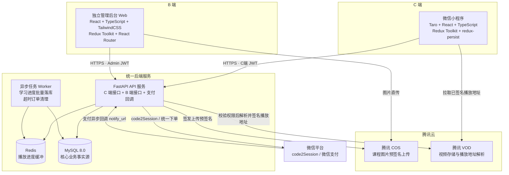
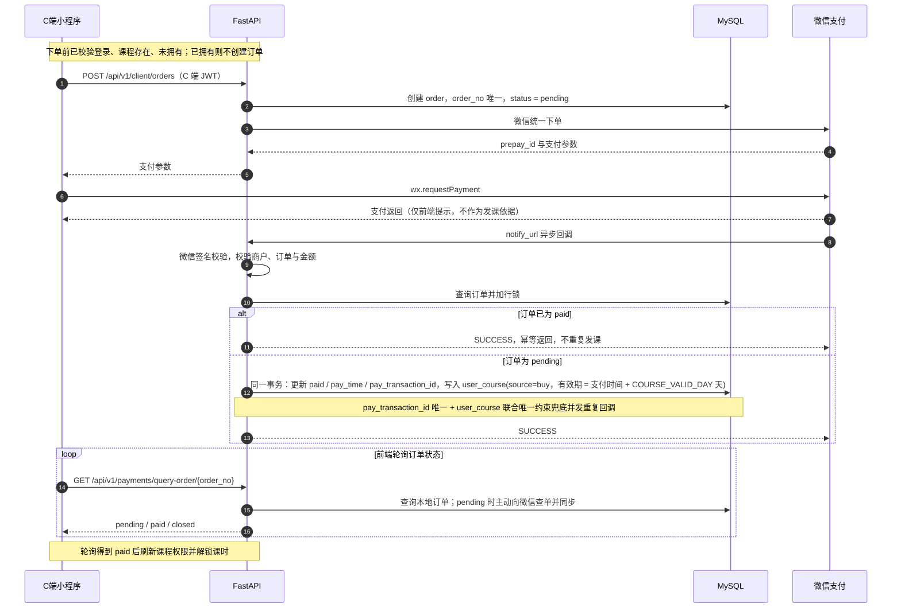
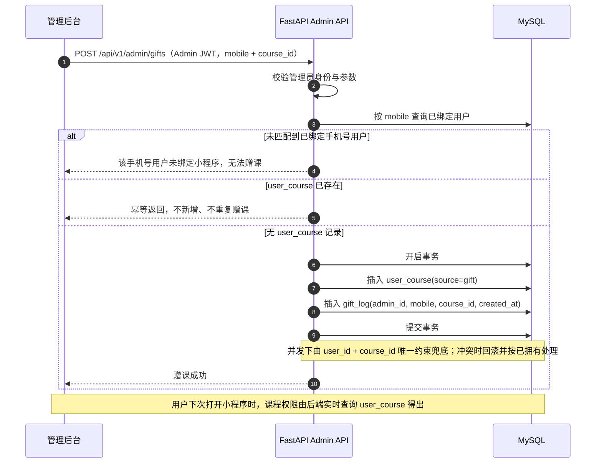
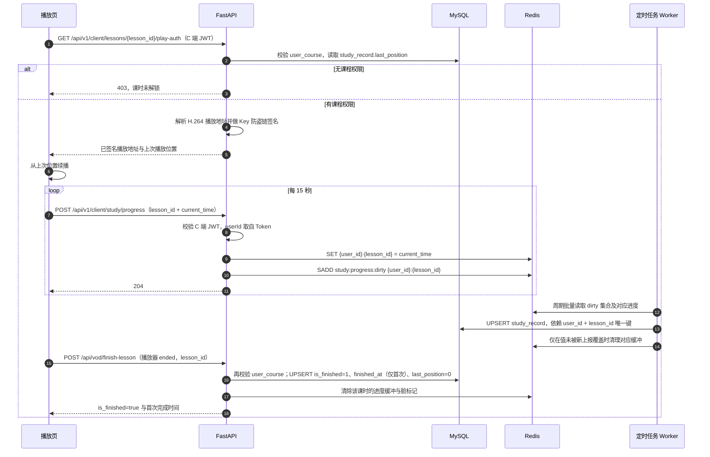
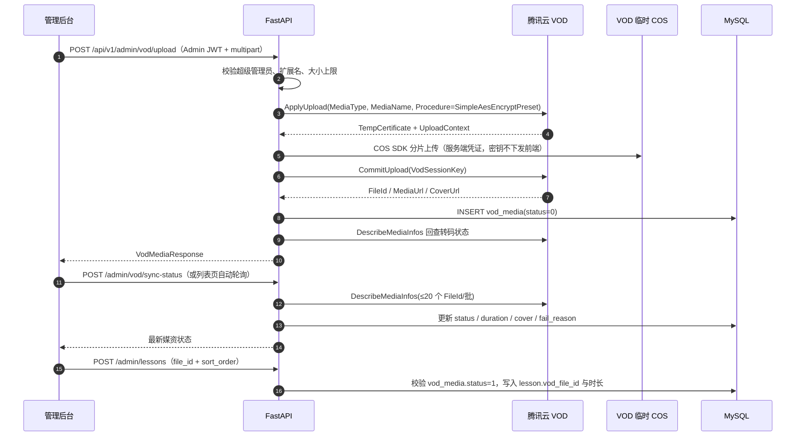

# 禾下美学院｜知识付费 · 系统架构设计

> 阶段：阶段 1（项目骨架与架构文档）
> 状态：仅定义目标架构、边界与不变量，不包含业务代码、依赖安装、数据库迁移和部署编排。

---

## 1. 文档边界

本文档是全项目后续阶段共同遵循的架构基线，重点回答四件事：

1. 系统由哪些独立部署单元组成，各自职责是什么；
2. C 端、B 端、支付回调三条鉴权链路如何隔离；
3. 支付发课、后台赠课、学习进度上报三个核心流程如何保证正确与幂等；
4. 哪些业务能力在本项目范围内，哪些明确禁止开发。

后续阶段的接口、数据表、页面实现均不得突破本文档定义的边界与不变量。

---

## 2. 系统组成与技术栈

| 组成 | 技术栈 | 职责 |
| --- | --- | --- |
| C 端小程序 `miniprogram/` | Taro + React + TypeScript + Redux Toolkit + redux-persist | 首页、商学院课程广场、课程详情、视频播放、个人中心 |
| B 端后台 `admin-web/` | React + TypeScript + Redux Toolkit + react-router-dom + TailwindCSS + axios | 管理员登录、课程/课时管理、赠课、用户课程管理、赠课日志、订单查询、系统配置 |
| 统一 API `backend/` | FastAPI + Python 3.11 + 异步 SQLAlchemy + Alembic + MySQL 8.0 + Redis | 同时服务 C 端与 B 端，签发播放鉴权，处理支付回调与异步任务 |
| 部署 `deploy/` | Docker + Docker Compose + Nginx | 本地开发与生产两套编排、反向代理、静态站点与密钥挂载 |
| 云服务 | 腾讯 COS + 腾讯 VOD + 微信支付 | 图片预签名上传、VOD 鉴权播放、微信统一下单与异步回调 |

**架构原则：**

- **单一后端、双端隔离**：C 端与 B 端共用一个 API 服务，但使用两套独立 JWT 密钥和独立路由命名空间，权限完全隔离。
- **MySQL 为唯一事实源**：课程、订单、课程拥有关系、学习进度最终数据均落 MySQL；Redis 只承担缓冲、短期状态和缓存。
- **服务端裁决权限**：课时是否解锁、是否允许播放、是否可赠课，全部由后端根据 `user_course` 计算，前端不自行判断。
- **幂等靠约束兜底**：业务查询只能减少冲突，唯一索引和事务才是最终一致性保障。
- **敏感信息只留在后端**：小程序密钥、支付私钥、COS/VOD 密钥、Admin JWT 密钥不得下发到任意前端。

---

## 3. 整体架构图



**部署形态：**

- API 服务与定时任务 Worker 使用同一份后端代码、不同启动入口，避免多 API 副本重复执行定时任务。
- B 端后台是独立静态站点，由 Nginx 托管；C 端小程序由微信开发者工具构建并上传，不通过 Docker 部署。
- 本地开发使用一套 Compose，生产使用另一套 Compose；两者共享镜像构建逻辑但不共享配置与密钥。

---

## 4. 目录职责

```text
beauty-course-mp/
├── miniprogram/
│   ├── config/                     # Taro 编译配置与环境区分
│   └── src/
│       ├── api/                    # C 端请求封装、拦截器
│       ├── assets/                 # 小程序静态资源
│       ├── components/             # C 端通用组件
│       ├── constants/              # 常量、枚举、默认配置
│       ├── pages/
│       │   ├── home/               # 首页
│       │   ├── academy/            # 商学院课程广场
│       │   ├── course-detail/      # 课程详情
│       │   ├── player/             # 视频播放页
│       │   └── profile/            # 个人中心
│       ├── store/
│       │   └── slices/             # Redux Toolkit 状态切片
│       ├── types/                  # C 端 TypeScript 类型
│       └── utils/                   # 请求、登录、播放进度等工具
├── admin-web/
│   ├── public/                     # B 端静态资源
│   └── src/
│       ├── api/                    # 管理后台请求封装、Admin Token 注入
│       ├── components/             # 后台通用组件
│       ├── layouts/                # 后台布局与导航
│       ├── pages/
│       │   ├── login/              # 管理员登录
│       │   ├── courses/            # 课程管理
│       │   ├── lessons/            # 课时管理
│       │   ├── gifts/              # 赠课发放
│       │   ├── gift-logs/          # 赠课日志查询
│       │   ├── orders/             # 订单查询
│       │   └── system-config/      # 系统配置管理
│       ├── router/                 # 路由与登录守卫
│       ├── store/
│       │   └── slices/             # 后台 Redux 状态
│       ├── styles/                 # TailwindCSS 入口与全局样式
│       ├── types/                  # B 端 TypeScript 类型
│       └── utils/                   # Token、日期、上传等工具
├── backend/
│   ├── alembic/
│   │   └── versions/               # 数据库迁移脚本
│   ├── app/
│   │   ├── api/
│   │   │   ├── admin/              # B 端接口，Admin JWT
│   │   │   ├── client/             # C 端接口，C 端 JWT
│   │   │   └── payment/            # 微信支付回调，仅签名校验
│   │   ├── core/                   # 配置、数据库、Redis、安全、异常
│   │   ├── models/                 # SQLAlchemy 模型
│   │   ├── schemas/                # Pydantic 请求/响应模型
│   │   ├── services/               # 业务服务：课程、订单、赠课、播放等
│   │   ├── tasks/                  # 进度批量落库、超时订单清理
│   │   └── utils/                   # 微信、COS、VOD、通用工具
│   ├── scripts/                    # 初始化管理员、默认配置等脚本
│   ├── tests/                      # 后端测试
│   ├── Dockerfile                  # Python 3.11 运行镜像
│   ├── requirements.txt            # 后端依赖
│   └── .dockerignore
├── deploy/
│   ├── docker-compose.dev.yml      # 本地开发编排
│   ├── docker-compose.prod.yml     # 生产编排
│   ├── deploy.sh                   # 生产发布、健康检查与回滚
│   ├── nginx/
│   │   ├── nginx.conf              # HTTPS、API 代理、后台 SPA、gzip
│   │   └── certs/                  # TLS 证书，本地提供，不入库
│   └── secrets/                    # 支付私钥等，本地提供，不入库
├── docs/
│   └── ARCHITECTURE.md             # 本架构文档
├── .env.example                    # 环境变量模板，不含真实密钥
├── .gitignore
├── README_DEV.md                   # 本地开发说明
└── README_PROD.md                  # 生产部署说明
```

---

## 5. 领域模型与数据不变量

### 5.1 实体关系

- `user` 1 : N `order`、`user_course`、`study_record`
- `course` 1 : N `lesson`、`order`、`user_course`、`gift_log`
- `admin_user` 1 : N `gift_log`、`vod_media`
- `vod_media` 1 : N `lesson`（通过 `lesson.vod_file_id = vod_media.file_id`，同一视频可被多个课时复用）
- `system_config` 为独立配置表，不依赖业务实体

### 5.2 核心实体

| 实体 | 核心字段 | 约束与说明 |
| --- | --- | --- |
| `user` | `id`、`openid`、`mobile`、`created_at`、`updated_at` | `openid` 唯一；`mobile` 可为 `NULL`；赠课只依赖 `mobile` 匹配 |
| `course` | `id`、`title`、`lecturer`、`description`、`price`、`cover_big`、`cover_small`、`icon_url`、`is_hot_topic` | 三张图片地址相互独立；`is_hot_topic` 驱动首页热门板块 |
| `lesson` | `id`、`course_id`、`title`、`vod_file_id`、`duration_seconds`、`sort_order` | 归属唯一课程；课时不可单独售卖；`vod_file_id` 关联 `vod_media.file_id`；时长由媒资 / VOD 回填，`0` 表示尚未取得；列表按 `(sort_order, id)` 升序 |
| `vod_media` | `id`、`file_id`、`video_name`、`duration_seconds`、`cover_url`、`uploader_id`、`status`、`fail_reason` | `file_id` 唯一；`status` 0=转码中 / 1=正常可用 / 2=失败；上传成功才写库，失败不产生脏记录 |
| `order` | `id`、`order_no`、`user_id`、`course_id`、`amount`、`status`、`paid_at`、`created_at` | `order_no` 全局唯一；`status` 为 `pending` / `paid` / `closed` / `refunded` |
| `user_course` | `id`、`user_id`、`course_id`、`source`、`valid_start_at`、`valid_end_at`、`created_at` | 联合唯一 `(user_id, course_id)`；`source` 枚举 `buy` / `gift`；有效期 UTC 存储，两列均为空表示永久有效 |
| `user_course_log` | `id`、`admin_id`、`user_id`、`course_id`、`action`、`expire_time`、`valid_days`、`created_at` | 后台赠送 / 重置 / 收回课程留痕；`action` 为 `gift` / `reset` / `revoke`；只增不改 |
| `study_record` | `id`、`user_id`、`lesson_id`、`last_position`、`is_finished`、`finished_at`、`updated_at` | 联合唯一 `(user_id, lesson_id)`；保存最近播放位置与首次看完时间 |
| `admin_user` | `id`、`username`、`password_hash`、`role`、`created_at` | `username` 唯一；密码只存不可逆哈希；`role` 为 `super` / `normal`，默认 `super` |
| `gift_log` | `id`、`admin_id`、`mobile`、`course_id`、`created_at` | 每次真实赠课留痕；记录操作管理员、手机号、课程、时间 |
| `system_config` | `id`、`config_key`、`config_value`、`default_value`、`description`、`updated_at` | `config_key` 唯一；默认值用于后台一键重置 |

> 说明：`order` 是 MySQL 保留字。领域实体名保持 `order`，实现阶段需对物理表名使用反引号或统一映射为 `orders`，不影响本文档的领域语义。

### 5.3 关键不变量

1. 一次购买解锁课程下全部课时，不存在按课时售卖或按课时授权的数据模型。
2. 判断用户是否拥有课程，只查 `user_course`，不依赖订单状态或前端缓存。
3. 订单回调成功与发放课程必须处于同一事务；`user_course` 唯一约束是重复发课的最后一道防线。
4. 同一用户 + 同一课程只能存在一条 `user_course`；后台重复赠课只重置有效期（`source` 置为 `gift`），不得新增拥有关系；每次操作写入 `user_course_log`。
5. `study_record` 每个用户、每个课时只有一条记录，只更新最近位置，不统计学习时长与完成率。
6. 系统配置只能修改预设文本项，Tab 数量固定为 2，禁止新增、删除或重排 Tab。
7. 课时只能绑定媒资库中 `status=1` 的视频；转码中或失败的视频不得绑定。
8. 同一 `vod_media.file_id` 可被多个课时复用，上传是媒资入库的唯一入口；课时只保存 FileId，不保存播放地址。

---

## 6. 权限与鉴权

### 6.1 双 JWT 完全隔离

| 维度 | C 端用户 JWT | B 端管理员 JWT |
| --- | --- | --- |
| 签发对象 | 微信用户 | `admin_user` |
| 密钥 | `USER_JWT_SECRET` | `ADMIN_JWT_SECRET`（必须不同） |
| 载荷 | 用户标识、令牌类型 | 管理员标识、令牌类型 |
| 存储 | redux-persist | localStorage |
| 请求头 | `Authorization: Bearer <C-JWT>` | `Authorization: Bearer <Admin-JWT>` |
| 路由空间 | `/api/v1/client/*` | `/api/v1/admin/*` |
| 校验依赖 | C 端专用鉴权依赖 | Admin 专用鉴权依赖 |

两类 Token 不可互换：C 端 Token 访问后台接口必须 401，Admin Token 访问 C 端用户接口也必须 401。

### 6.2 访问规则

- **免登录浏览**：首页、首页热门课程模块、系统配置读取接口。
- **强制登录**：商学院课程广场、课程详情、视频播放页、个人中心、下单、播放鉴权、进度上报。
- **手机号绑定**：可选能力。只影响能否被后台赠课，不影响登录、购买、播放。
- **B 端**：除登录页外，所有后台路由和接口均需 Admin JWT；退出时同时清空 Token 与 Redux 状态。
- **B 端角色**：`admin_user.role=super` 可上传媒资、同步转码状态、新建 / 编辑 / 删除课时；`role=normal` 仅可读取课程、课时、媒资、赠课日志、订单与配置。角色在每次请求时从数据库读取，调整后立即生效。
- **支付回调**：唯一免 JWT 的业务入口，仅允许微信签名校验，并独立校验商户号、订单存在性与金额。
- **资源级权限**：登录只证明身份；课时是否解锁、能否获取 VOD 播放地址，必须继续校验 `user_course`。

### 6.3 权限鉴权数据流图

```mermaid
flowchart TD
    subgraph CS["C 端登录与鉴权"]
        C1["小程序启动"] --> C2["wx.login 获取 code"]
        C2 --> C3["POST /api/v1/client/auth/wx-login"]
        C3 --> C4["后端 code2Session 换取 openid"]
        C4 --> C5{"openid 是否存在？"}
        C5 -->|"否"| C6["创建 user<br/>mobile = null"]
        C5 -->|"是"| C7["读取既有 user"]
        C6 --> C8["签发 C 端 JWT"]
        C7 --> C8
        C8 --> C9["redux-persist 持久化"]
        C9 --> C10["请求头 Authorization: Bearer C-JWT"]
        C10 --> C11["C 端专用密钥验签"]
        C11 --> C12{"资源级权限校验<br/>user_course 是否存在"}
        C12 -->|"是"| C13["返回数据 / 已签名播放地址"]
        C12 -->|"否"| C14["课时加锁 / 引导购买"]
        C9 -.->|"可选，用户主动触发"| C15["getPhoneNumber 授权"]
        C15 --> C16["后端解密并写入 user.mobile"]
    end

    subgraph AS["B 端登录与鉴权"]
        A1["访问管理后台"] --> A2{"路由守卫<br/>localStorage 有 Admin JWT？"}
        A2 -->|"否"| A3["重定向管理员登录页"]
        A3 --> A7["提交账号密码"]
        A7 --> A8["校验 password_hash"]
        A8 -->|"通过"| A9["签发 Admin JWT"]
        A9 --> A10["localStorage 持久化"]
        A10 --> A4
        A2 -->|"是"| A4["请求头 Authorization: Bearer Admin-JWT"]
        A4 --> A5["Admin 专用密钥验签"]
        A5 --> A6["管理员接口"]
        A6 -.->|"退出"| A11["清空 localStorage 与 Redux"]
    end

    subgraph PS["支付回调例外"]
        P1["微信支付 notify_url"] --> P2["不校验 JWT<br/>仅校验微信签名"]
        P2 --> P3["订单幂等处理"]
    end
```



### 6.4 API 边界

| 路由前缀 | 鉴权方式 | 说明 |
| --- | --- | --- |
| `/api/v1/client/auth/*` | 登录接口免 JWT；绑定手机号需 C 端 JWT | 微信静默登录、可选手机号绑定 |
| `/api/v1/client/*` | C 端 JWT（按接口要求） | 个人资料、课程、订单、播放鉴权、进度上报 |
| `/api/v1/admin/*` | Admin JWT | 后台全部管理能力 |
| `/api/v1/payments/wechat/notify` | 无 JWT，微信签名 | 微信支付异步回调 |
| `/api/v1/config` | 免 JWT 只读 | C 端 onShow 拉取系统配置 |

> 上传预签名接口属于 `/api/v1/admin/*`，必须管理员鉴权后才能签发；课程图片由后台直传 COS，后端不中转二进制。
>
> C 端头像不同：微信仅提供临时本地文件，且 COS 密钥不得下发小程序，因此头像经 `/api/v1/client/user/avatar` 由后端校验后代理写入 COS（≤5MB、JPG/PNG/WebP），返回公网地址存库。
>
> 课程视频又不同：VOD 上传需要服务端 `ApplyUpload` 临时凭证，无法安全下发浏览器，因此视频二进制经 `/api/v1/admin/vod/upload` 由后端中转，上传与转码全部在服务端完成。

---

## 7. 核心流程

### 7.1 微信支付与回调幂等

**前置约束：**

- 下单前校验登录、课程存在、是否已拥有；已拥有直接提示，不生成订单。
- `order_no` 全局唯一，订单创建后状态为 `pending`。
- 前端支付结果不作为发课依据，只以服务端订单状态为准。
- 用户取消支付时订单维持 `pending`，可重新发起；下单满 30 分钟仍待支付的可通过 `/payments/close-order` 关闭为 `closed`。
- 订单状态为 `pending` / `paid` / `closed` / `refunded`；`refunded` 仅保留历史数据，不提供退款接口。



**一致性要点：**

- 回调验签通过后，以数据库行锁串行化同一订单处理；已 `paid` 直接返回成功。
- 发课与订单状态更新同事务提交，避免“已扣款但未发课”或“已发课但订单未完成”。
- 同一订单重复回调不得新增第二条 `user_course`，也不得重复累加任何权益。
- 前端轮询仅拉起状态刷新，不得绕过服务端权限判断直接解锁。

### 7.2 后台赠课幂等

**前置约束：**

- 只允许匹配已绑定手机号的用户；未绑定手机号用户不可被赠课。
- 同一手机号 + 同一课程只能存在一条 `user_course`。
- 只有真实新增拥有关系时才写 `gift_log`；重复请求不产生新日志。



**一致性要点：**

- 先查后写仅用于友好提示，最终幂等依赖数据库唯一约束。
- 若并发插入触发唯一约束冲突，事务回滚，按“已拥有”返回，不写第二条日志。
- 赠课成功不推送、不修改用户客户端缓存；C 端每次进入相关页面以服务端权限为准。

### 7.3 视频播放与进度上报

**前置约束：**

- 播放鉴权必须校验 C 端 JWT 与 `user_course`；无权限直接拒绝，不返回播放地址。
- 视频存于腾讯云 VOD；后端基于 `vod_file_id` 调用 DescribeMediaInfos 解析 H.264 MP4 地址，
  并按 Key 防盗链规则签名后下发，小程序用原生 video 组件播放。
- 播放进度每 15 秒上报一次，先写 Redis，再由 Worker 批量落库。
- 播放器触发 `ended` 后调用 `POST /api/vod/finish-lesson`；接口再次校验
  `user_course`，写入 `is_finished` / 首次 `finished_at`，把续播位置归零，
  并清理 Redis 中待落库的旧进度。
- `study_record` 只保存最近播放位置与是否看完，不统计累计时长、完成率或排名。

**客户端播放器说明（重要）：**

- 本项目使用微信原生 `<video>`，**不是 H5 的 TCPlayer**。原生 controls 的内部元素由微信客户端绘制，
  无法重排，也无法把自定义按钮放入原生控制栏。
- 为还原“左侧播放/时间、中间进度、右侧倍速/自动/全屏”的悬浮控制栏，
  普通模式与全屏统一使用 `controls={false}` 自绘控制层，进度条使用原生 `<Slider>`
  （非手绘 View）。
- 全屏采用页面内全屏：播放器 `fixed` 覆盖整个视口，播放页通过
  `<PageMeta pageOrientation='landscape'>` 切为横屏（页面配置 `enablePageMeta: true`），
  退出时显式改回 `portrait`。不使用 `VideoContext.requestFullScreen()`，因为微信原生
  全屏会接管控制栏，倍速、自动连播等自定义按钮无法显示。
- 全屏状态由页面持有并通过 `fullscreen` 属性传入播放器；自动连播切换课时导致播放器
  重挂载后仍保持横屏，不会闪回竖屏。开发者工具可模拟横屏旋转，实际机型仍需真机验收。
- 进入 / 退出全屏不重挂 `<video>`、不改 `src`，只切换覆盖层 class 与页面方向，因此不重新
  拉流、不重新鉴权，播放进度与播放状态保持连续。切换窗口内（900ms）抑制 `onWaiting`
  的 loading 浮层，避免旋转瞬间闪黑；250ms 后对切换前处于播放中的视频主动 `play()`
  续播；若个别机型把进度重置到开头且用户未手动拖动，则 `seek()` 回切换前位置。
- 播放页使用 `navigationStyle: "custom"` 自绘深色导航栏（返回箭头 + 课时标题），
  全屏时整条导航栏不渲染；全屏左上角为视频画面内的返回按钮（半透明黑色圆形 + 白色返回箭头），
  右侧为当前课时导航标题胶囊（金色圆点 + 单行省略，与竖屏导航栏文字一致，切换课时后更新），
  右侧预留微信胶囊宽度。只有全屏状态出现，底部控制栏只保留
  播放/时间/进度/倍速/自动。右上角胶囊是微信系统控件，无法通过小程序 API 隐藏，
  只能做深色视觉适配。
- 横屏下 rpx 会按屏幕宽度整体放大，因此全屏控制栏、退出按钮、课时标题、倍速面板等尺寸统一使用
  大写 `PX`（Taro 不转 rpx）：控制栏 44px、正文 13px、退出按钮 38px、课时标题胶囊 30px。
- 【倍速】在视频画面右侧弹出深黑半透明圆角面板，固定 0.5X / 0.75X / 1.0X / 1.25X / 1.5X / 2.0X，
  当前速率浅金色高亮；面板只覆盖视频画面、不遮挡底部控制栏，点击面板外或再次点【倍速】关闭。
- 播放器正下方常驻本课程全部课时列表（纯文字，无封面）：标题、时长、学习状态。
  当前课时浅金底色/文字并标“播放中”，已看完课时带“✅ 已完成”。列表数据来自课程详情
  `lessons[].duration_seconds` / `is_finished`；时长由后端从 VOD 媒资信息解析并落库
  （`lessons.duration_seconds`），播放鉴权时也会顺带回填。
- 课时切换与自动连播均在播放页内完成：点击列表条目只重新请求 `play-auth` 并替换视频
  （播放器按 `lessonId + play_url` 重挂载），不新增页面栈，切换后自动开始播放并从
  `last_position` 续播；【自动】默认开启，仅在存在下一课时时于播放结束后
  展示 5 秒倒计时及【立即播放】【取消】。关闭【自动】后播放结束不弹倒计时、不切换课时。
- 自动连播与完成上报相互独立：无论是否开启自动连播，`ended` 都会调用
  `finish-lesson` 标记本课已看完。



### 7.4 视频上传与媒资库

**目标**：后台不再手工粘贴 FileId。管理员上传本地视频，服务端完成 VOD 上传并自动触发加密转码任务流；课件从媒资库选择已就绪的视频绑定。



- **上传链路**：二进制经后端中转（不是浏览器直传），因为 ApplyUpload 临时凭证与 VOD 密钥只能在服务端持有；前端仅展示上传进度，不接触任何密钥。
- **自动转码**：`ApplyUpload` 的 `Procedure` 使用 `VOD_UPLOAD_PROCEDURE`（默认 `SimpleAesEncryptPreset`，AES-128 加密自适应 HLS），无需管理员手工在 VOD 控制台建任务流。
- **状态机**：转码任务全部完成 → `status=1`（任务显式返回 `FINISH`，或线上仅返回产物 `Url` 而无 `Status` 时视为完成）；仍有 `PROCESSING`、无产物地址或无任务 → `0`；任一任务 `ERROR` 或 `ErrCode≠0` → `2` 并记录 `fail_reason`。后台列表在有 `status=0` 记录时每 8 秒自动同步一次，全部完成即停止轮询；课时选择弹窗也仅在存在转码中视频时轮询。
- **失败不产生脏数据**：Apply / PUT / Commit 任一失败返回 502，且不写 `vod_media`；同步失败保留原状态，不覆盖已有可用数据。
- **媒体复用**：课时只绑定 `vod_media.file_id`，多个课时可复用同一视频；不能修改已有播放链路，播放鉴权仍按 `lessons.vod_file_id` + psign 签发，小程序无感知。
- **展示信息维护**：后台只能修改 `video_name`；封面由 VOD 自动截取视频首帧生成，不提供修改或上传入口。状态同步会以 VOD 首帧截图回填 `cover_url`，名称保留后台修改值。上传后只立即同步一次转码状态，封面在转码完成后由列表页轮询补全；FileId、时长、状态由 VOD 决定。
- **删除边界**：删除只移除本地 `vod_media` 记录，不删除腾讯云 VOD 原文件；存在课时引用（`lessons.vod_file_id`）时返回 `409 VOD_MEDIA_IN_USE`，必须先解绑，保证已购用户播放不受影响。管理后台点击确认后立即关闭弹窗，失败结果通过页面顶部提示展示。
- **时长与排序**：绑定课时时自动写入媒资时长（缺失时回查 VOD）；课时列表按 `sort_order`、`id` 升序，C 端课程详情课时列表使用同一排序。

### 7.5 学习进度缓冲设计

- **进度主键**：严格按基线使用 `{user_id}:{lesson_id}` 作为 Redis Key，Value 为最近一次的 `current_time`。
- **脏集合索引**：额外维护 `study:progress:dirty` 集合，避免定时任务使用 `KEYS` 全量扫描；集合成员为 `{user_id}:{lesson_id}`。
- **TTL**：进度 Key 设置过期时间，防止用户长期不活跃产生永久脏数据；过期后以 MySQL 已落库位置为准。
- **落库方式**：使用 MySQL `INSERT ... ON DUPLICATE KEY UPDATE` 或等价 upsert，保证 `study_record` 只有一条。
- **并发清理**：Worker 读取进度、upsert 成功后，仅当 Redis 当前值仍等于已落库值时清理；若期间有新进度写入，则保留新值等待下一轮，避免清理掉未落库数据。
- **续播来源**：播放鉴权读取 MySQL 中的 `study_record.last_position`；Redis 是缓冲层，不直接作为最终事实源。
- **失败处理**：Redis 写入失败不影响播放本身；Worker 落库失败时保留脏集合成员，下一周期重试。
- **完成标记**：`finish-lesson` 以 MySQL 为准写入 `is_finished` / `finished_at`，
  随后删除该课时的进度 Key 与脏集合成员；即使清理失败，下一次播放仍按
  `last_position=0` 开始，不会把用户卡在片尾。

---

## 8. 系统配置

- 数据源：`system_config` 表，`config_key` 唯一，`default_value` 保存初始默认值。
- 初始化：服务启动时幂等补齐缺失配置，**不得覆盖管理员已修改的值**。
- 读取：小程序各页面 `onShow` 拉取全量配置并缓存到 Redux；接口异常时使用前端内置默认值兜底。
- 应用：首页标题、板块标题、搜索占位、弹窗文案直接渲染；底部 Tab 固定两个，仅通过 `setTabBarItem` 动态修改文字，禁止增删 Tab。
- 管理：B 端配置页支持查看、编辑 `config_value`、一键重置为 `default_value`；不允许修改配置键。
- 边界：配置仅承载展示文案，不承载权限、价格、开关类业务逻辑。

---

## 9. 部署与环境

### 9.1 本地开发

- Compose 启动 MySQL、Redis、FastAPI；B 端由 Node 容器运行 Vite 开发服务器；C 端通过微信开发者工具加载 Taro 构建产物。
- 开发环境回调地址使用可访问的公网 HTTPS 隧道；微信支付与 VOD 的真实密钥只放在本地 `.env`，不提交仓库。
- 编排文件：`deploy/docker-compose.dev.yml`；异步任务 Worker 在定时任务阶段加入。

### 9.2 生产环境

- Nginx 负责 TLS、B 端静态站点托管、API 反向代理与上传大小限制。
- 生产使用独立域名访问 B 端后台，C 端与 B 端不共享页面代码。
- 当前生产编排：`deploy/docker-compose.prod.yml` 提供 FastAPI、MySQL、Redis、Nginx；后续加入 Worker，Worker 必须单实例或使用分布式锁，避免定时任务重复执行。
- MySQL、Redis 使用持久化数据卷；生产密钥通过环境变量或挂载密钥文件注入。
- 支付回调必须为公网可达的 HTTPS 地址，并配置在微信支付商户平台。
- C 端图片走 COS/CDN，视频走腾讯 VOD，不经后端转发媒体流。

### 9.3 环境变量

- 模板统一维护在根目录 `.env.example`，真实 `.env` 永不入库。
- C 端与 B 端只暴露 API Base URL 等非敏感变量，禁止打包任何私钥或服务端密钥。
- VOD 上传相关：`VOD_UPLOAD_PROCEDURE`（加密转码任务流模板名，默认 `SimpleAesEncryptPreset`）与 `VOD_UPLOAD_MAX_SIZE_MB`（单文件大小上限，默认 2048）；`TENCENT_VOD_*` / `TENCENT_COS_*` 密钥仅服务端使用。

---

## 10. 业务范围边界

### 10.1 允许实现

- C 端：首页、商学院课程广场、课程详情、视频播放页、个人中心。
- B 端：管理员登录/退出、课程管理、课时管理、媒资上传与复用、赠课发放、用户课程管理（赠送 / 重置有效期 / 收回）、赠课日志查询、订单查询、系统配置管理。
- 登录：微信静默登录、可选手机号绑定。
- 交易：整课购买、微信支付、支付回调幂等发课、订单查询。
- 学习：VOD 鉴权播放、15 秒进度上报、Redis 缓冲、批量落库、续播。

### 10.2 严禁实现

试看、退款、评论、收藏、优惠券、分销、直播、社群、打卡、题库、积分、会员体系。

### 10.3 后台能力边界

后台不提供下单能力、不提供视频播放能力；订单仅查询，不触达微信支付、不修改支付结果。后台的用户课程管理只能创建 / 更新 / 删除 `user_course` 授权并写入操作日志，必须遵守 `(user_id, course_id)` 唯一约束，不得直接改写学习进度。媒资上传与课时写操作仅超级管理员可用；后台不提供视频预览、下载或播放地址。

---

## 11. 架构不变量清单

开发与验收时逐项核对：

1. `user.openid` 唯一，`mobile` 允许为空。
2. 首页热门课程与系统配置可免登录读取；课程广场、详情、播放强制登录。
3. C 端 JWT 与 Admin JWT 使用不同密钥、不同存储、不同路由空间。
4. 支付回调不做 JWT 鉴权，只做微信签名校验；回调处理必须幂等，已支付订单不重复发课。
5. `order.order_no` 全局唯一，`order.pay_transaction_id` 全局唯一；订单状态为 `pending` / `paid` / `closed` / `refunded`，取消支付不改变状态，超时关单置为 `closed`。
6. `user_course` 联合唯一 `(user_id, course_id)`，`source` 仅 `buy` / `gift`。
7. 赠课只能匹配已绑定手机号用户；后台重复赠课 / 重置有效期不新增拥有关系，只更新有效期并写入操作日志；收回权限需删除授权并留痕。
8. 课时解锁与 VOD 播放地址必须经过服务端 `user_course` 校验。
9. 播放进度先写 Redis，Worker 周期批量 upsert；`study_record` 联合唯一 `(user_id, lesson_id)`，只存最近位置。
10. `system_config.config_key` 唯一；Tab 固定 2 个，只允许修改文字；前端必须有默认配置兜底。
11. 所有黑名单功能一律不开发，后台不提供下单与视频播放能力。
